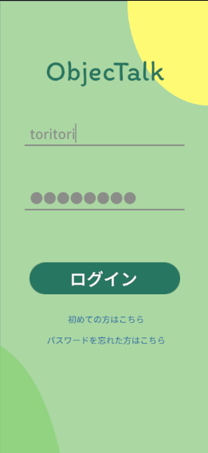
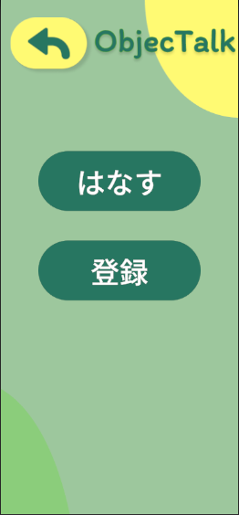
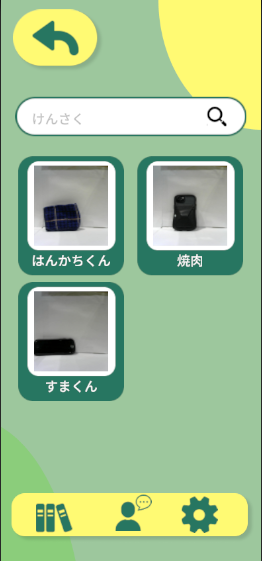
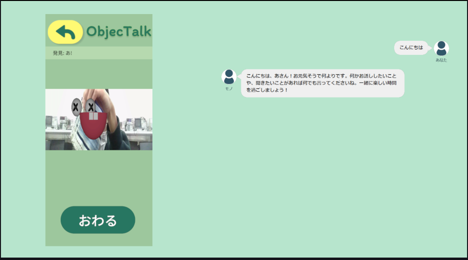
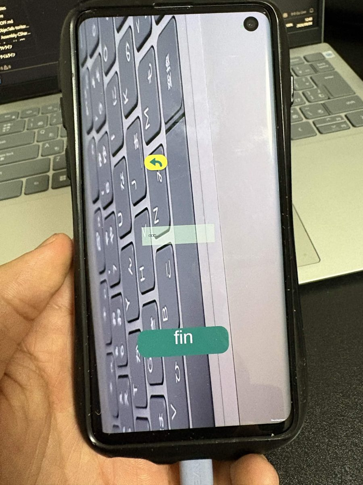

# ObjecTalk

Point an Android phone at a registered object and have a short, hands-free Japanese
voice conversation "as" that object. Recognition runs on-device (an embedding model +
optional local feature verification); the conversation runs through the OpenAI Realtime
API, brokered by a small backend that never exposes the API key.

## 概要（日本語）

ObjecTalk は、Android スマホを登録したモノに向けると、そのモノになりきって音声で会話できるアプリです。

- **物体認識は端末上で実行**します（埋め込みモデル＋局所特徴による照合）。カメラに映ったモノが、登録済みのどれかを判定します
- **会話は OpenAI Realtime API** で行います。接続は自前のバックエンドが中継し、API キーをクライアントに渡しません
- モノごとに人格（口調や設定）を持たせることができ、天気や Web 検索などのツールも使えます

構成は Unity クライアント（Android）と Node.js / Express のバックエンドです。バックエンドは Firebase 認証の検証、会話の指示文の生成、Realtime 接続の仲介、日次予算によるレート制限を担います。

## 画面

ログイン画面:



ホーム画面（「はなす」「登録」）:



登録したモノの一覧・検索画面:



会話画面（認識したモノに目と口が付き、そのモノとして返事をします）:



実機で動かしている様子:



## 使い方の流れ

1. **モノを登録する**: 会話したいモノを撮影して登録します。モノごとに人格（口調や設定）を持たせられます
2. **スマホを向ける**: カメラをモノに向けると、端末上のモデルが登録済みのモノかどうかを判定します
3. **会話が始まる**: 認識したモノになりきって、音声で会話が始まります。天気や Web 検索などのツールも使えます

## 技術構成

| 部分 | 技術 |
| :--- | :--- |
| クライアント | Unity 6000.1.7f1（Android、IL2CPP）。登録・端末上の物体認識・会話UI |
| 物体認識 | 埋め込みモデルによる照合 ＋ AKAZE 局所特徴による検証（OpenCV for Unity）。通信なしで端末だけで判定する |
| 音声会話 | OpenAI Realtime API。接続はバックエンドが中継し、API キーはクライアントに渡さない |
| バックエンド | Node.js 20 / Express。Firebase 認証の検証、会話の指示文の生成、Realtime 接続の仲介、日次予算によるレート制限 |

## Repository layout

| Path | What |
|---|---|
| `ObjecTalk-toritori(1)/` | The Unity project (Unity 6000.1.7f1, IL2CPP, Android). Client app: registration, on-device recognition, and the Talk UI. |
| `Backend/` | Node.js 20 / Express service. Verifies the Firebase ID token, builds server-owned instructions, creates the OpenAI Realtime call, returns the SDP answer. See `Backend/README.md`. |
| `ObjecTalk-toritori(1)/docs/superpowers/` | Design specs and implementation plans (some are historical — each carries a status banner). |
| `Backend/docs/dev-device-verification.md` | Runbook for verifying the whole flow on a physical device against a local backend. |

## Building the Unity client

**A fresh clone does not build as-is.** These large trees are intentionally *not* in Git
and must be re-imported into `ObjecTalk-toritori(1)/Assets/` before opening the project:

- `OpenCV+Unity/` — the OpenCV for Unity Asset Store package (local AKAZE verification).
  Without an arm64 native lib the app falls back to embedding-only recognition.
- `Firebase/` — the Firebase Unity SDK (Auth).
- The rest of `Plugins/` beyond the two tracked fix files
  (`Plugins/SQLite.cs`, `Plugins/Android/AndroidManifest.xml`).

Two Unity 6000.1.7f1 installs may exist on a build machine; **only the one whose
`Editor/Data/PlaybackEngines/AndroidPlayer/` contains `NDK` / `SDK` / `OpenJDK`
(usually the `-x86_64` folder) can produce the APK.** Set the three
`*UseEmbedded` External-Tools preferences to "on" so Unity uses its bundled toolchain.

Dev APK (batchmode, needs ~5 min warm):

```
<Unity.exe> -batchmode -quit -projectPath ObjecTalk-toritori(1) -buildTarget Android \
  -executeMethod ObjecTalk.EditorTools.DevBuild.BuildAndroidDev -logFile build.log -accept-apiupdate
```

Output: `ObjecTalk-toritori(1)/Builds/Android/ObjecTalk-dev.apk`. `[MenuItem "Build/Android Development APK"]` does the same interactively.

## Tests

- Unity: EditMode and PlayMode suites via the Unity Test Runner (or `-runTests -testPlatform EditMode|PlayMode` in batchmode).
- Backend: `cd Backend && npm ci && npm test` (Node's built-in test runner).

## Running the whole flow on a device

Build + install the dev APK, run the backend locally, forward the port with
`adb reverse tcp:8080 tcp:8080` (this is dropped by every Android build — re-run it),
point `TalkConfiguration` in `ObjectDetectionScene.unity` at `http://localhost:8080`.
Full steps: `Backend/docs/dev-device-verification.md`.
